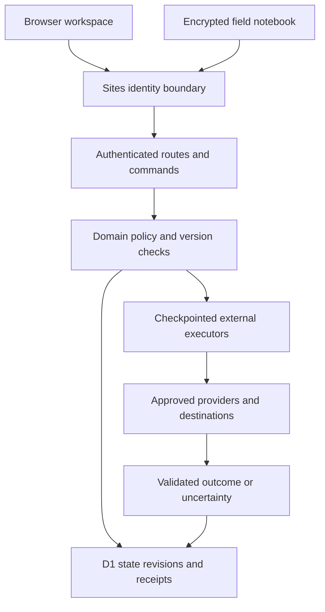

# High level design

The current deployment is a Sites-hosted React/Vinext application on a Cloudflare Worker with D1 persistence. It is a modular server with a browser client and a separate static field notebook. The [original HLD](../reference/02_High-Level-Design_v1.0.md) remains the product architecture proposal; it is not a description of the installed stack.

| Component | Source | Responsibility |
| --- | --- | --- |
| Workspace and panels | `app/workspace.tsx`, `app/*-panel.tsx` | Patient context, forms, explicit review and role-filtered navigation |
| Identity adapter | `app/chatgpt-auth.ts` | Read authenticated Sites dispatcher headers; no independent general-purpose OIDC implementation |
| Routes and dispatcher | `app/api/`, `lib/saha/server.ts` | Bounded input, origin checks, identity, membership, idempotency and dispatch |
| Domain policy | `lib/saha/*.ts` | Current scope, state machines, version/dependency binding and safety gates |
| Persistence | `lib/saha/store.ts`, `db/schema.ts`, `drizzle/` | Organisation CAS, atomic dependent writes, revisions, audit and receipts |
| External executors | `agent-execution.ts`, `mis-execution.ts`, `ehr-execution.ts`, `evaluation-execution.ts` under `lib/saha/` | Commit checkpoint before network request, validate outcome and retain uncertainty |
| Notebook | `public/field/`, `lib/saha/field.ts` | Encrypted local drafts, signed limited grants, sync/conflict behavior |
| Operations | `monitoring.ts`, `operations*.ts`, `scripts/recovery.mjs` | Scoped metrics/incidents/maintenance and local encrypted snapshot recovery |

## Material differences from the proposed architecture

The runtime uses D1/SQLite, application scope checks and organisation-level serialization. It does not implement PostgreSQL RLS, separated PostgreSQL service roles or a fully normalized 26-entity clinical store. Do not apply `docs/history/v1.0/engineering/001_foundation.sql` to this application.

The field client is a browser notebook rather than the proposed native Android application. It does not establish hardware-backed key custody or reliable disconnected operation on a physical device. The application uses explicit execution commands; it has no general autonomous distributed worker or sixteen-event delivery bus matching the original event catalogue.

The original ten-role model is a target. The current membership roles are ASHA, clinician, supervisor and administrator, with owner authority separately represented. Approval reviewer identities and governance ownership add workflow checks, not new general-purpose roles.

## Scaling and custody

Organisation state loading and one revision guard constrain concurrency and payload size. Before R15 scale claims, measure representative organisations, query plans, contention, history growth, queues and failure recovery. Any move to finer-grained storage must preserve atomic authority checks, exact receipts, append-only evidence and external uncertainty. Choose architecture changes from measured evidence; do not migrate persistence merely to match a historical diagram.

See [ADR reconciliation](ARCHITECTURE-DECISIONS.md) and [data model](05_Data-Model-Specification_v1.1.md).
