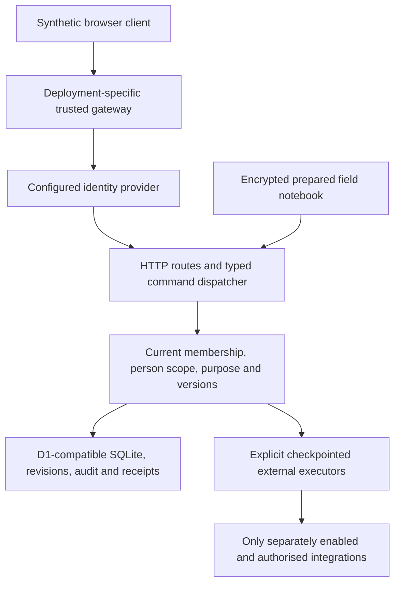
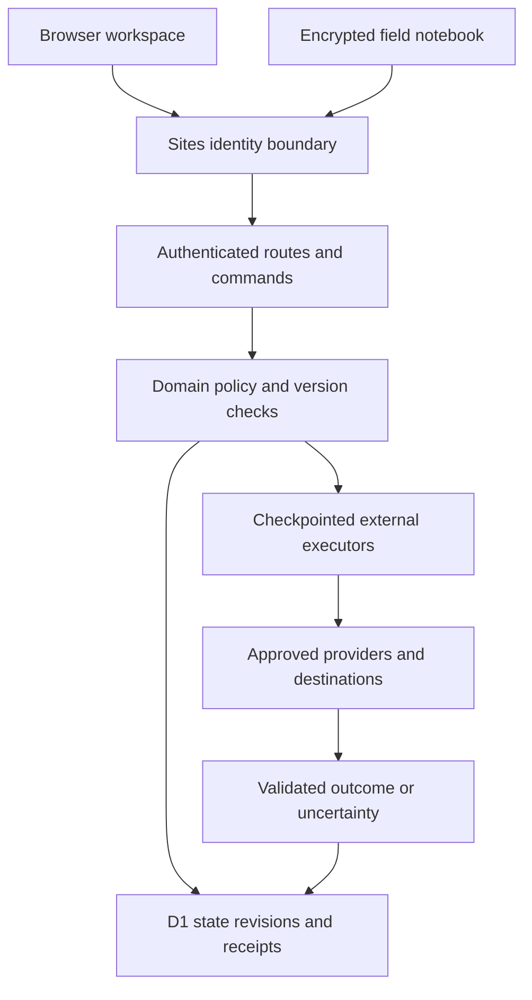

# High level design

## Current source reconciliation — 10 October 2026

Use this supplement and [the current engineering baseline](engineering-handoff/CURRENT-ENGINEERING-BASELINE.md)
for the 11 October coding handoff. Inspected source is main
`7668a03d97c1ae62174f09e65ccd5a5717120be6`. The retained R11 text below is an earlier implementation
description. Where it differs from this dated supplement, it does not describe the current source or documented
hosting arrangement. This revision changes documentation only and performs no live inspection or application test.

The application remains a modular Vinext/React server and browser client using Workers APIs and D1-compatible
SQLite persistence. [Documented synthetic hosting](../../deploy/README.md) runs the built Worker through
`wrangler dev --local` on the shared DigitalOcean droplet, with persisted local D1 state and Caddy at
`https://health.aplyd.org`. The [8 October hosting checkpoint](HOSTED-STAGING.md) records the Cloudflare copy as
frozen. Repository configuration is evidence of intended behavior; neither a merge nor the presence of this
document establishes the currently running commit.

| Current responsibility | Authoritative source / boundary |
| --- | --- |
| Worker request entry and scheduled handler | [worker/index.ts](../../worker/index.ts) rejects cross-site requests before routing and delegates scheduled work to the existing domain handler. |
| Trusted identity | [lib/saha/identity.ts](../../lib/saha/identity.ts) selects exactly one provider. `server.ts` resolves it before domain work. Sites-style trusted headers and verified Cloudflare Access tokens are alternative configured paths, not interchangeable public headers. |
| Documented droplet gateway | Caddy supplies identity after its synthetic basic-auth boundary. [Droplet configuration](../../deploy/make-droplet-config.mjs) selects `sites-chatgpt`; Cloudflare Access is not the droplet's configured provider. This remains a private synthetic demonstration, not production workforce identity. |
| Browser entry points | Existing workspace and field notebook remain. [Today](../../app/today/today.tsx) and [todayRead](../../lib/saha/today-server.ts) supply the isolated, assigned-person, read-only D02 path. D03 routine review/save is a separate unpublished candidate, not a main route in this baseline. |
| Authority and persistence | [server.ts](../../lib/saha/server.ts), [store.ts](../../lib/saha/store.ts) and [partition.ts](../../lib/saha/partition.ts) preserve current access checks, command receipts and atomic guarded writes. Certified patient work can use patient guards; other work retains organisation scope. Do not assume a single organisation-wide guard for every command. |
| Current interfaces and storage | Read [the generated API inventory](CURRENT-API-INVENTORY.md), [data dictionary](CURRENT-DATA-DICTIONARY.md) and applied SQL source. The original PostgreSQL/REST/event/native-client architecture remains a target design. |
| Field continuity | [public/field/](../../public/field/) and [field.ts](../../lib/saha/field.ts) provide encrypted prepared work and guarded sync. An Android wrapper exists separately; neither source presence nor browser tests establish native keystore or physical-device durability acceptance. |

Recommended architectural default for the next slice: reuse these current components and isolate presentation
changes. No new patient database, PostgreSQL migration, provider, hosting resource or autonomous execution layer is
needed to qualify the preserved D03 manual candidate. A new architecture choice requires its own evidence and
versioned decision, not reinterpretation of a historical ADR.

## Retained R11 implementation description

The remainder retains the original edition text for provenance. Its Sites-only identity, hosting and universal
organisation-serialization descriptions are superseded above for the inspected source baseline.

# High level design

The current deployment is a Sites-hosted React/Vinext application on a Cloudflare Worker with D1 persistence. It is a modular server with a browser client and a separate static field notebook. The [original HLD](../reference/02_High-Level-Design_v1.0.md) remains the product architecture proposal; it is not a description of the installed stack.

| Component | Source | Responsibility |
| --- | --- | --- |
| Workspace and panels | `app/workspace.tsx`, `app/*-panel.tsx` | Patient context, forms, explicit review and role-filtered navigation |
| Identity adapter | `app/chatgpt-auth.ts` | Read authenticated Sites dispatcher headers; no independent general-purpose OIDC implementation |
| Routes and dispatcher | `app/api/`, `lib/saha/server.ts` | Bounded input, origin checks, identity, membership, idempotency and dispatch |
| Domain policy | `lib/saha/*.ts` | Current scope, state machines, version/dependency binding and safety gates |
| Persistence | `lib/saha/store.ts`, `db/schema.ts`, `drizzle/` | Organisation CAS, atomic dependent writes, revisions, audit and receipts |
| External executors | `agent-execution.ts`, `mis-execution.ts`, `ehr-execution.ts`, `evaluation-execution.ts` under `lib/saha/` | Commit checkpoint before network request, validate outcome and retain uncertainty |
| Notebook | `public/field/`, `lib/saha/field.ts` | Encrypted local drafts, signed limited grants, sync/conflict behavior |
| Operations | `monitoring.ts`, `operations*.ts`, `scripts/recovery.mjs` | Scoped metrics/incidents/maintenance and local encrypted snapshot recovery |

## Material differences from the proposed architecture

The runtime uses D1/SQLite, application scope checks and organisation-level serialization. It does not implement PostgreSQL RLS, separated PostgreSQL service roles or a fully normalized 26-entity clinical store. Do not apply `docs/history/v1.0/engineering/001_foundation.sql` to this application.

The field client is a browser notebook rather than the proposed native Android application. It does not establish hardware-backed key custody or reliable disconnected operation on a physical device. The application uses explicit execution commands; it has no general autonomous distributed worker or sixteen-event delivery bus matching the original event catalogue.

The original ten-role model is a target. The current membership roles are ASHA, clinician, supervisor and administrator, with owner authority separately represented. Approval reviewer identities and governance ownership add workflow checks, not new general-purpose roles.

## Scaling and custody

Organisation state loading and one revision guard constrain concurrency and payload size. Before R15 scale claims, measure representative organisations, query plans, contention, history growth, queues and failure recovery. Any move to finer-grained storage must preserve atomic authority checks, exact receipts, append-only evidence and external uncertainty. Choose architecture changes from measured evidence; do not migrate persistence merely to match a historical diagram.

See [ADR reconciliation](ARCHITECTURE-DECISIONS.md) and [data model](05_Data-Model-Specification_v1.1.md).
